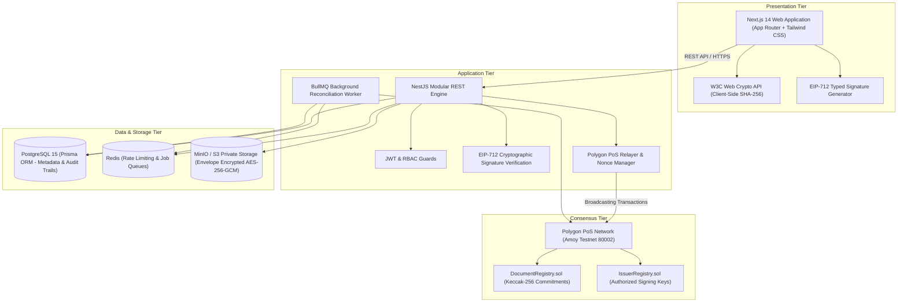

# DocAuth: Decentralized Multi-Document Authentication Platform

[](https://polygon.technology/)
[](https://nextjs.org/)
[](https://nestjs.com/)
[](https://soliditylang.org/)
[](https://www.typescriptlang.org/)
[](packages/contracts/test)
[](LICENSE)

An enterprise-grade, cryptographically verifiable multi-document authentication and verification platform anchored on the **Polygon Proof-of-Stake (PoS)** blockchain.

DocAuth resolves the vulnerability of centralized certificate repositories to unauthorized SQL manipulation, insider fraud, and single points of failure by decoupling credential verification into **client-side zero-knowledge hashing**, **EIP-712 structured digital signatures**, and **immutable on-chain state commitments**.

---

## Key Highlights

- **Zero-Egress Document Privacy:** Document bytes never leave client browser memory during verification. Cryptographic SHA-256 byte digests are calculated locally via the native W3C Web Crypto API (`window.crypto.subtle.digest`).
- **Three-Dimensional Trust Model:** Strictly separates:
  1. **Document Integrity:** Local byte digest matches on-chain Keccak-256 commitment.
  2. **Issuer Authenticity:** EIP-712 typed digital signature validates against authorized issuer keys.
  3. **Blockchain State:** Real-time on-chain confirmation that the credential and issuing organization are active and unrevoked.
- **Gas-Efficient On-Chain Registry:** Smart contracts (`DocumentRegistry.sol` and `IssuerRegistry.sol`) anchor 32-byte Keccak-256 commitments with $\mathcal{O}(1)$ gas consumption, shielding the network from heavy payload storage costs.
- **Instant Cascading Revocation:** Platform governance can suspend or revoke an organization or specific document, instantly nullifying all associated credentials across all verifiers globally.
- **Role-Based Portals:** Tailored user experiences for Public Verifiers, Issuing Organizations, Super Administrators, and Credential Holders.

---

## System Architecture



---

## Platform Modules & Capabilities

| Portal | Route | Description |
| :--- | :--- | :--- |
| **Public Verifier** | `/verify` | Instant, gas-free document verification. Drag-and-drop any PDF; hashes in local browser memory with 0 bytes uploaded across the network. Returns a complete cryptographic audit dossier. |
| **Issuer Portal** | `/organizations/dashboard` | Author new credentials, manage EIP-712 signing key versions, inspect issued documents, and execute on-chain document revocations. |
| **Super Admin** | `/admin` | Enterprise governance dashboard. Approve applicant organizations, inspect system-wide audit logs, manage key compromise timestamps, and execute cascading organizational revocations. |
| **Public Issuer Directory** | `/issuers` | Searchable public catalog of all verified institutional issuers with privacy controls (configurable direct contact phone and authorized HR signers). |
| **Credential Wallet** | `/wallet` | Recipient interface to inspect acquired verifiable credentials, generate QR codes, and issue time-limited sharing tokens. |

---

## Cryptographic Security Protocol

### 1. Zero-Knowledge Commitment Formula
To prevent dictionary attacks and rainbow table lookups while keeping personal document contents off-chain, commitments are computed as:

$$\text{Commitment} = \text{Keccak-256}(\text{SHA-256}(\text{Document Bytes}) \parallel \text{IssuerID} \parallel \text{Nonce})$$

Where:
- $\text{SHA-256}(\text{Document Bytes})$ is computed inside the user's browser using W3C Web Crypto.
- $\text{IssuerID}$ is the unique on-chain identifier of the registered issuing entity.
- $\text{Nonce}$ is a cryptographically secure 256-bit random entropy value generated via a CSPRNG.

### 2. EIP-712 Structured Data Envelope
Issuance and revocation meta-transactions use EIP-712 typed structured hashing to protect signers from blind signing attacks and cross-contract replays:

```typescript
const EIP712Domain = [
  { name: 'name', type: 'string' },
  { name: 'version', type: 'string' },
  { name: 'chainId', type: 'uint256' },
  { name: 'verifyingContract', type: 'address' }
];

const DocumentCredential = [
  { name: 'credentialId', type: 'bytes32' },
  { name: 'documentHash', type: 'bytes32' },
  { name: 'recipientHash', type: 'bytes32' },
  { name: 'issuedAt', type: 'uint256' },
  { name: 'expiresAt', type: 'uint256' }
];
```

---

## Monorepo Directory Structure

```text
├── apps/
│   ├── web/                    # Next.js 14 App Router frontend (Public Verifier, Issuer & Admin portals)
│   ├── api/                    # NestJS modular enterprise API (Auth, Orgs, Documents, Verification)
│   └── worker/                 # BullMQ asynchronous background worker (Reconciliation & On-chain indexer)
├── packages/
│   ├── contracts/              # Solidity contracts (DocumentRegistry, IssuerRegistry) & Hardhat suite
│   ├── crypto/                 # Cryptographic utilities (W3C WebCrypto, EIP-712, Keccak-256, Envelope)
│   ├── shared/                 # Monorepo-wide shared TypeScript interfaces, enums, DTOs, and schemas
│   └── blockchain-client/      # Ethers.js v6 abstraction provider and typechain bindings
├── docs/                       # Technical specifications, architecture docs, and database schema
├── docker-compose.yml          # Containerized PostgreSQL 15, Redis, and MinIO storage
├── package.json                # Root pnpm workspaces definition
└── pnpm-workspace.yaml         # Monorepo workspace orchestration
```

---

## Quickstart Guide

### 1. Prerequisites
- **Node.js:** `>= 20.x`
- **pnpm:** `>= 9.x`
- **Docker & Docker Compose** (for PostgreSQL, Redis, MinIO)

### 2. Installation
```bash
# Clone the repository
git clone https://github.com/<your-username>/<your-repo-name>.git
cd <your-repo-name>

# Install workspace dependencies
pnpm install
```

### 3. Environment Setup
```bash
# Copy sample configuration
cp .env.example .env
```
Update `.env` with your Polygon Amoy RPC URL and testnet deployer private key if deploying to live testnet.

### 4. Start Infrastructure Containers
```bash
docker compose up -d
```

### 5. Smart Contracts & Database Setup
```bash
# Compile and run automated contract tests (61 tests)
pnpm --filter @docauth/contracts test

# Generate Prisma client and run migrations
pnpm --filter @docauth/api prisma:generate
pnpm --filter @docauth/api prisma:migrate:dev
```

### 6. Run Application in Development
```bash
pnpm dev
```

* **Frontend Web Application:** [http://localhost:3000](http://localhost:3000)
* **Backend REST API:** [http://localhost:4000/api/v1](http://localhost:4000/api/v1)
* **Interactive Swagger Documentation:** [http://localhost:4000/api/docs](http://localhost:4000/api/docs)
* **MinIO Object Storage Console:** [http://localhost:9001](http://localhost:9001)

---

## Automated Test Coverage

The platform contains **61 automated test scenarios** validating edge cases, including:

```bash
pnpm --filter @docauth/contracts test
```

- [x] Client-Side WebCrypto SHA-256 byte digest generation (0 KB network egress)
- [x] Single-byte alteration detection across authentic PDFs
- [x] EIP-712 typed signature verification & signer address recovery
- [x] Gas-efficient state commitment registration on Polygon EVM
- [x] Re-registration prevention for previously anchored document fingerprints
- [x] Verification invalidation on organizational suspension
- [x] Instant global nullification on organizational revocation
- [x] On-chain document revocation lifecycle

---

## License

This project is licensed under the **MIT License** — see the [LICENSE](LICENSE) file for details.
