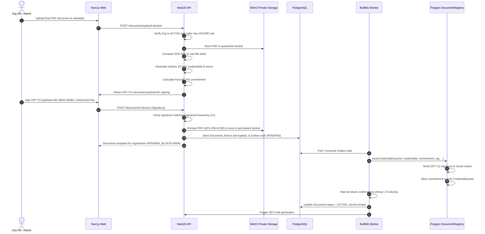
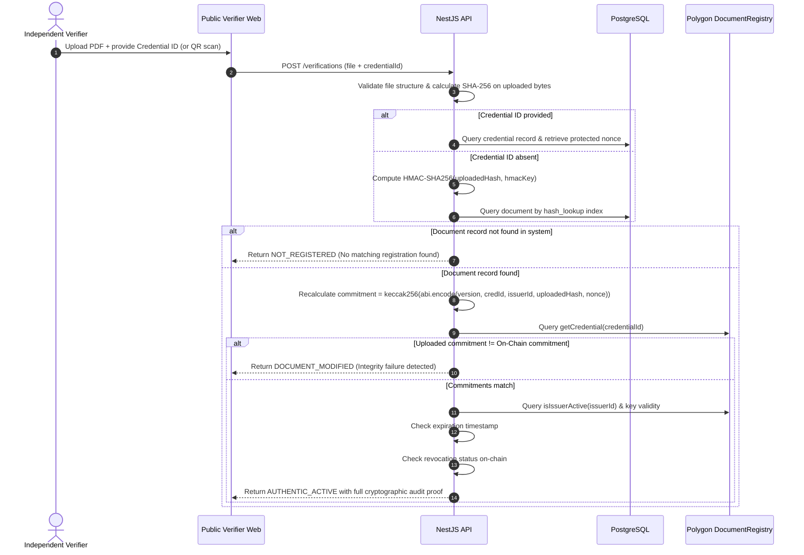

# System Architecture Specification

## 1. Executive Overview

The **Decentralized Multi-Document Authentication and Verification Platform** is an enterprise-grade infrastructure designed to provide independent, tamper-evident, and cryptographically verifiable proof of authenticity for organizational documents (academic degrees, university marksheets, experience letters, certifications, employment verifications, and professional licenses).

The platform bridges off-chain enterprise document management with on-chain cryptographic attestations on **Polygon PoS**, ensuring that:
1. Document contents are strictly private and never published on public blockchains.
2. Even single-character modifications to an issued PDF are immediately identified as integrity violations.
3. Trust is partitioned into three distinct, non-conflated dimensions: Document Integrity, Issuer Authenticity, and Organizational Trust.
4. Independent verifiers can validate document authenticity without requiring centralized platform permissions.

---

## 2. The Three Fundamental Trust Dimensions

A core architectural principle of this platform is the strict separation of trust dimensions. Verifying a document is **never** a single boolean check.

```mermaid
flowchart TD
    subgraph D1["1. Document Integrity"]
        H1["Uploaded File Bytes"] --> H2["SHA-256 Fingerprint"]
        H2 --> H3["Recompute Commitment with Nonce"]
        H3 --> H4["Exact Match with Blockchain Commitment?"]
    end

    subgraph D2["2. Issuer Authenticity"]
        S1["EIP-712 Issuance Signature"] --> S2["Recover Signer Public Key"]
        S2 --> S3["Authorized Key in IssuerRegistry at Issuance Time?"]
        S3 --> S4["Valid Key Version and Not Compromised?"]
    end

    subgraph D3["3. Organizational Trust"]
        O1["Issuer ID"] --> O2["IssuerRegistry Contract Status"]
        O2 --> O3["Platform Admin Vetting & Accreditation"]
        O3 --> O4["Active Status vs Suspended / Revoked?"]
    end

    D1 & D2 & D3 --> V["Authoritative Multi-Dimensional Verdict"]
```



### Distinction Table

| Dimension | Meaning | Verification Mechanism | Failure Mode |
|---|---|---|---|
| **Document Integrity** | Is the uploaded file identical byte-for-byte to the registered original? | Recalculate Keccak-256 commitment using uploaded PDF SHA-256 + nonce and compare with on-chain record | `DOCUMENT_MODIFIED` |
| **Issuer Authenticity** | Was this specific document authorized by an approved signing key of the stated organization? | Verify EIP-712 structured data signature and cross-check against `IssuerRegistry` key history | `SIGNATURE_INVALID` or `ISSUER_KEY_COMPROMISED` |
| **Organizational Trust** | Is the issuing entity a legitimate, legally compliant organization verified by governance? | Check `IssuerStatus` on Polygon (`ACTIVE`, `SUSPENDED`, `REVOKED`) and administrative accreditation | `ISSUER_SUSPENDED` or `ISSUER_REVOKED` |

> [!IMPORTANT]
> A valid cryptographic hash alone **does not** prove that an organization is genuine or that the contents of a certificate are true. An attacker could register a fake organization and issue a cryptographically intact fraudulent certificate. All three dimensions must independently evaluate to valid.

---

## 3. High-Level Component Architecture

The platform follows a modular monolith pattern for the application layer with distinct operational boundaries.

```text
+-----------------------------------------------------------------------------------+
|                                  CLIENT TIER                                      |
|                                                                                   |
|  [Admin Dashboard]      [Org Issuance Portal]    [Holder Wallet]   [Public Verifier] |
|                                Next.js (App Router)                               |
+------------------------------------------+----------------------------------------+
                                           | HTTPS / REST v1
                                           v
+-----------------------------------------------------------------------------------+
|                                 APPLICATION TIER                                  |
|                                                                                   |
|  +-----------------------------------------------------------------------------+  |
|  |                            NestJS Modular Monolith                          |  |
|  |                                                                             |  |
|  |  [Auth & RBAC]        [Org Verification]     [Issuer Keys]   [Doc Issuance] |  |
|  |  [Doc Hashing]        [Digital Signatures]   [Verification]  [Holder Wallet]|  |
|  |  [Revocation Engine]  [Audit Logger]         [QR Engine]     [Health/Observ]|  |
|  +-----------------------+----------------------+------------------------------+  |
|                          |                      |                                 |
|           Transactional  |                      | Enqueue                         |
|           Outbox         v                      v                                 |
|  +-----------------------------------------------------------------------------+  |
|  |                        Asynchronous Workers (BullMQ)                        |  |
|  |                                                                             |  |
|  |  [Doc Processing]    [Blockchain Relayer]   [Event Indexer] [Reconciler]    |  |
|  +-----------------------+----------------------+---------------+--------------+  |
+--------------------------|----------------------|---------------|-----------------+
                           |                      |               |
            +--------------+                      v               |
            |                            +------------------+     |
            v                            |  Redis (BullMQ)  |     |
+------------------------+               +------------------+     |
|   PostgreSQL + Prisma  |                                        |
|                        |                                        |
| - Users & Auth         |               +------------------+     |
| - Orgs & Issuer Keys   |               | Encrypted Storage|     |
| - Document Metadata    |               |  (MinIO / S3)    |     |
| - Nonces & Encrypted   |               |                  |     |
|   Document Hashes      |               | - Encrypted PDFs |     |
| - Tx Outbox & Events   |               | - Org Evidence   |     |
+------------------------+               +------------------+     |
                                                                  |
                                                                  | RPC (Ethers.js v6)
                                                                  v
+-----------------------------------------------------------------------------------+
|                             BLOCKCHAIN TIER (Polygon PoS)                         |
|                                                                                   |
|     +-----------------------------------+   +----------------------------------+  |
|     |         IssuerRegistry            |   |         DocumentRegistry         |  |
|     |                                   |   |                                  |  |
|     | - Org Registration & Status       |   | - EIP-712 Verification           |  |
|     | - Authorized Signing Keys         |   | - Commitment Storage             |  |
|     | - Key Versions & Compromise Times |   | - Credential Uniqueness & Status |  |
|     | - Emergency Pause Controls        |   | - Revocation Records & Events    |  |
|     +-----------------------------------+   +----------------------------------+  |
+-----------------------------------------------------------------------------------+
```

---

## 4. Subsystem Details

### 4.1 Client Tier (Next.js 14+)
- **Architecture:** React 18 / Next.js with TypeScript and Tailwind CSS.
- **Role-Based Portals:**
  - **Super Administrator:** Organization application vetting, status controls, platform telemetry, blockchain transaction monitor.
  - **Organization Portal:** Member management, authorized wallet key registration, document issuance wizard with client-side EIP-712 signing, revoked credentials list, audit logs.
  - **Holder Wallet:** Credential receipt, category filters (Degrees, Work, Licenses), privacy-preserving sharing link creation, verification activity tracker.
  - **Public Verifier:** Drag-and-drop PDF verifier, QR code scanner, credential ID manual lookup, step-by-step cryptographic audit report.

### 4.2 Application Tier (NestJS Backend)
- **Modularity:** 16 domain modules communicating through typed service calls and domain events.
- **Security & Authorization:** Argon2id password hashing, rotating JWT refresh tokens, tenant-isolation interceptor ensuring organizations cannot access unauthorized records.
- **Outbox Pattern:** Documents and pending blockchain transactions are written to the database in a single atomic transaction. The outbox processor picks up unsent items and dispatches them to BullMQ, guaranteeing at-least-once submission.

### 4.3 Asynchronous Workers (BullMQ + Redis)
- **Document Processing Worker:** Validates MIME types (magic bytes), runs malware checks, computes SHA-256 byte fingerprints, performs envelope encryption (AES-256-GCM), and pushes to MinIO.
- **Blockchain Relayer Worker:** Handles gas estimation, dynamic nonce management for the relayer wallet, transaction submission to Polygon, receipt confirmation (waiting for configured block confirmations), and error recovery.
- **Event Indexer Worker:** Continuously indexes emitted logs (`IssuerRegistered`, `CredentialIssued`, `CredentialRevoked`), updating database projections.
- **Reconciliation Worker:** Periodic background cron that scans on-chain contract state against PostgreSQL records to identify and reconcile any divergent states.

### 4.4 Data & Storage Tier
- **PostgreSQL 16:** Relational storage for application entities, structured audit logs, user permissions, and encrypted cryptographic metadata (protected nonces, wrapped keys, encrypted hashes).
- **MinIO / S3:** Private object storage. Raw PDF files are stored strictly encrypted at rest via envelope encryption. Direct public URL access is prohibited; downloads use time-limited (e.g. 5-minute) pre-signed URLs issued only to authorized holders or verifiers with active sharing tokens.

### 4.5 Blockchain Tier (Polygon Amoy / Mainnet)
- **`IssuerRegistry.sol`:** Stores opaque 32-byte `issuerId`, active/suspended/revoked status, and a history of authorized signing public keys mapped by `keyVersion`.
- **`DocumentRegistry.sol`:** Verifies that credentials are signed by authorized issuer keys using EIP-712, checks issuer status, stores the 32-byte privacy-preserving commitment, enforces credential uniqueness, and tracks revocation status.

---

## 5. Architectural Data Flows

### 5.1 Document Issuance Flow



### 5.2 Document Verification Flow



---

## 6. Tamper Detection Guarantee

Consider a certificate issued with:
- **Designation:** Junior Developer
- **Tenure:** 2024–2026

If the holder edits the PDF to say "Senior Developer", the binary bytes of the PDF stream change.
1. The verifier calculates SHA-256 on the modified bytes:
   $$\text{Hash}_{\text{modified}} \neq \text{Hash}_{\text{original}}$$
2. The verification engine combines $\text{Hash}_{\text{modified}}$ with the original $\text{Nonce}$:
   $$\text{Commitment}_{\text{modified}} = \text{Keccak-256}(\text{Version}, \text{ID}, \text{Issuer}, \text{Hash}_{\text{modified}}, \text{Nonce})$$
3. Because Keccak-256 is collision-resistant:
   $$\text{Commitment}_{\text{modified}} \neq \text{Commitment}_{\text{on-chain}}$$
4. The system produces an immediate **`DOCUMENT_MODIFIED`** verdict. The on-chain commitment remains untouched and immutable.

---

## 7. Scaling and Extensibility

1. **File Type Extensibility:** While the initial release focuses on PDF documents (using ISO 32000-1 magic byte validation), the underlying cryptographic hashing and commitment engine is agnostic to file formats. Images (PNG, TIFF), XML credentials, or CAD files can be accommodated without changing smart contracts.
2. **Multi-Validator Governance:** While Phase 3 uses administrative hybrid approval, the contract interface supports transitioning to a decentralized consortium of validator oracles without breaking the `IssuerRegistry` ABI.
3. **Multi-Chain Deployment:** The EIP-712 domain separator includes `chainId` and contract address, allowing the identical smart contract architecture to deploy to Arbitrum, Ethereum L1, or private Subnets without signature replay vulnerabilities.

