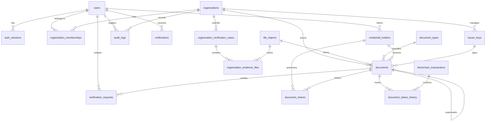

# Database Schema Specification

## 1. Overview and Design Principles

The database layer uses **PostgreSQL 16** managed via **Prisma ORM**. It serves as the application's secure metadata store, relation indexer, audit repository, and outbox dispatcher.

### Fundamental Data Layer Rules
1. **Blockchain as Source of Truth for Verification:** The blockchain is the authoritative source for whether an issuer is authorized, whether a credential commitment exists, and whether a document is revoked. PostgreSQL caches and indexes this state to accelerate UX and facilitate off-chain metadata lookups.
2. **Zero Plaintext Document Hashes or Nonces:** To protect privacy against database breach or insider threats, raw document SHA-256 hashes and credential nonces are stored encrypted using KMS-backed envelope encryption. Lookups by document hash are performed strictly through a keyed HMAC (`hash_lookup`).
3. **No Binary Files in Database:** Document files are stored in private object storage (MinIO / S3). Only metadata and storage keys reside in `file_objects`.
4. **UUIDv4 Primary Keys:** All application records use UUIDv4 (`gen_random_uuid()`) to prevent enumeration attacks and simplify distributed data ingestion.
5. **Strict Multi-Tenant Isolation:** All organization resources are bound by foreign keys to `organizations(id)` and verified through authorization middleware.

---

## 2. Entity-Relationship (ER) Diagram

---

## 3. Detailed Table Specifications

### 3.1 User & Identity Management

#### Table: `users`
Stores user identity for all platform actors (Platform Admins, Org Members, Credential Holders, Verifiers).

| Field | Type | Modifiers | Description |
|---|---|---|---|
| `id` | `UUID` | `PK, DEFAULT gen_random_uuid()` | Unique user identifier |
| `email` | `VARCHAR(255)` | `NOT NULL, UNIQUE` | Normalized lowercase email address |
| `password_hash` | `VARCHAR(255)` | `NOT NULL` | Argon2id password hash |
| `display_name` | `VARCHAR(100)` | `NOT NULL` | Full name of the user |
| `account_status` | `account_status_enum` | `NOT NULL, DEFAULT 'ACTIVE'` | `ACTIVE`, `SUSPENDED`, `LOCKED`, `DELETED` |
| `mfa_enabled` | `BOOLEAN` | `NOT NULL, DEFAULT false` | Whether TOTP MFA is configured |
| `mfa_secret_encrypted` | `TEXT` | `NULL` | Encrypted TOTP secret key |
| `created_at` | `TIMESTAMPTZ` | `NOT NULL, DEFAULT now()` | Registration timestamp |
| `updated_at` | `TIMESTAMPTZ` | `NOT NULL, DEFAULT now()` | Last update timestamp |

**Indexes:**
- `CREATE UNIQUE INDEX idx_users_email ON users(email);`

---

#### Table: `auth_sessions`
Tracks active sessions and implements secure refresh-token rotation with reuse detection.

| Field | Type | Modifiers | Description |
|---|---|---|---|
| `id` | `UUID` | `PK, DEFAULT gen_random_uuid()` | Session identifier |
| `user_id` | `UUID` | `NOT NULL, FK -> users(id) ON DELETE CASCADE` | Associated user |
| `refresh_token_hash` | `VARCHAR(64)` | `NOT NULL, UNIQUE` | SHA-256 hash of rotating refresh token |
| `ip_address` | `INET` | `NULL` | Client IP address at login |
| `user_agent` | `TEXT` | `NULL` | Client browser / device user-agent |
| `expires_at` | `TIMESTAMPTZ` | `NOT NULL` | Session absolute expiration |
| `revoked_at` | `TIMESTAMPTZ` | `NULL` | Timestamp if session was explicitly invalidated |
| `created_at` | `TIMESTAMPTZ` | `NOT NULL, DEFAULT now()` | Session creation timestamp |

**Indexes:**
- `CREATE INDEX idx_auth_sessions_user ON auth_sessions(user_id);`
- `CREATE UNIQUE INDEX idx_auth_sessions_token_hash ON auth_sessions(refresh_token_hash);`

---

#### Table: `organization_memberships`
Associates users with organizations under defined Role-Based Access Control (RBAC).

| Field | Type | Modifiers | Description |
|---|---|---|---|
| `id` | `UUID` | `PK, DEFAULT gen_random_uuid()` | Membership identifier |
| `organization_id` | `UUID` | `NOT NULL, FK -> organizations(id) ON DELETE CASCADE` | Associated organization |
| `user_id` | `UUID` | `NOT NULL, FK -> users(id) ON DELETE CASCADE` | Associated user |
| `role` | `org_role_enum` | `NOT NULL` | `ORG_ADMIN`, `ISSUER`, `REVIEWER`, `MEMBER` |
| `membership_status` | `membership_status_enum`| `NOT NULL, DEFAULT 'ACTIVE'` | `INVITED`, `ACTIVE`, `SUSPENDED`, `REMOVED` |
| `created_at` | `TIMESTAMPTZ` | `NOT NULL, DEFAULT now()` | Join timestamp |

**Indexes:**
- `CREATE UNIQUE INDEX idx_org_memberships_unique ON organization_memberships(organization_id, user_id);`
- `CREATE INDEX idx_org_memberships_user ON organization_memberships(user_id);`

---

### 3.2 Organization & Issuer Registry

#### Table: `organizations`
Stores institutional profile and on-chain issuer bindings.

| Field | Type | Modifiers | Description |
|---|---|---|---|
| `id` | `UUID` | `PK, DEFAULT gen_random_uuid()` | Internal database identifier |
| `issuer_id` | `BYTEA` | `NULL, UNIQUE` | 32-byte opaque issuer ID registered on-chain |
| `legal_name` | `VARCHAR(255)` | `NOT NULL` | Official legal business name |
| `registration_number_encrypted` | `TEXT` | `NOT NULL` | Envelope-encrypted government registration number |
| `organization_type` | `org_type_enum` | `NOT NULL` | `UNIVERSITY`, `CORPORATION`, `GOVERNMENT`, `TRAINING_INSTITUTE`, `OTHER` |
| `website` | `VARCHAR(255)` | `NOT NULL` | Official organization website |
| `verification_status` | `org_status_enum` | `NOT NULL, DEFAULT 'PENDING'` | `PENDING`, `UNDER_REVIEW`, `APPROVED`, `ACTIVE`, `REJECTED`, `SUSPENDED`, `REVOKED` |
| `created_at` | `TIMESTAMPTZ` | `NOT NULL, DEFAULT now()` | Creation timestamp |
| `updated_at` | `TIMESTAMPTZ` | `NOT NULL, DEFAULT now()` | Last update timestamp |

**Indexes:**
- `CREATE UNIQUE INDEX idx_organizations_issuer_id ON organizations(issuer_id) WHERE issuer_id IS NOT NULL;`
- `CREATE INDEX idx_organizations_status ON organizations(verification_status);`

---

#### Table: `organization_verification_cases`
Admin audit trail for organization vetting decisions.

| Field | Type | Modifiers | Description |
|---|---|---|---|
| `id` | `UUID` | `PK, DEFAULT gen_random_uuid()` | Verification case ID |
| `organization_id` | `UUID` | `NOT NULL, FK -> organizations(id)` | Target organization |
| `submitted_by` | `UUID` | `NOT NULL, FK -> users(id)` | User who submitted the application |
| `assigned_reviewer` | `UUID` | `NULL, FK -> users(id)` | Platform administrator assigned |
| `review_status` | `review_status_enum` | `NOT NULL, DEFAULT 'SUBMITTED'` | `SUBMITTED`, `IN_REVIEW`, `DECIDED` |
| `decision` | `case_decision_enum` | `NULL` | `APPROVED`, `REJECTED`, `NEEDS_INFORMATION` |
| `reviewer_notes` | `TEXT` | `NULL` | Internal notes regarding the decision |
| `submitted_at` | `TIMESTAMPTZ` | `NOT NULL, DEFAULT now()` | Submission timestamp |
| `reviewed_at` | `TIMESTAMPTZ` | `NULL` | Decision timestamp |

---

#### Table: `organization_evidence_files`
Uploaded legal evidence (registration certificates, tax certificates).

| Field | Type | Modifiers | Description |
|---|---|---|---|
| `id` | `UUID` | `PK, DEFAULT gen_random_uuid()` | Evidence record ID |
| `verification_case_id`| `UUID` | `NOT NULL, FK -> organization_verification_cases(id)`| Associated verification case |
| `file_object_id` | `UUID` | `NOT NULL, FK -> file_objects(id)` | Reference to private storage record |
| `evidence_type` | `VARCHAR(100)` | `NOT NULL` | e.g. `CERTIFICATE_OF_INCORPORATION`, `TAX_ID` |

---

#### Table: `issuer_keys`
Tracks authorized public signing keys for an organization on Polygon.

| Field | Type | Modifiers | Description |
|---|---|---|---|
| `id` | `UUID` | `PK, DEFAULT gen_random_uuid()` | Key record ID |
| `organization_id` | `UUID` | `NOT NULL, FK -> organizations(id)` | Associated organization |
| `key_version` | `INTEGER` | `NOT NULL` | Sequential key version (`1`, `2`, `3`...) |
| `wallet_address` | `VARCHAR(42)` | `NOT NULL` | Public Ethereum wallet address (`0x...`) |
| `key_status` | `key_status_enum` | `NOT NULL, DEFAULT 'ACTIVE'` | `ACTIVE`, `ROTATED`, `REVOKED`, `COMPROMISED` |
| `effective_at` | `TIMESTAMPTZ` | `NOT NULL, DEFAULT now()` | Activation timestamp |
| `revoked_at` | `TIMESTAMPTZ` | `NULL` | Revocation timestamp |
| `compromised_at` | `TIMESTAMPTZ` | `NULL` | If compromised, timestamp backdated to compromise |

**Indexes:**
- `CREATE UNIQUE INDEX idx_issuer_keys_org_version ON issuer_keys(organization_id, key_version);`
- `CREATE INDEX idx_issuer_keys_wallet ON issuer_keys(wallet_address);`

---

### 3.3 Document & Storage Layer

#### Table: `document_types`
Extensible classification for supported document categories.

| Field | Type | Modifiers | Description |
|---|---|---|---|
| `id` | `UUID` | `PK, DEFAULT gen_random_uuid()` | Type ID |
| `code` | `VARCHAR(50)` | `NOT NULL, UNIQUE` | Unique code (e.g. `DEGREE`, `EXPERIENCE_LETTER`) |
| `display_name` | `VARCHAR(100)` | `NOT NULL` | Human-readable title |
| `schema_version` | `INTEGER` | `NOT NULL, DEFAULT 1` | Metadata schema version |
| `active` | `BOOLEAN` | `NOT NULL, DEFAULT true` | Active flag |

---

#### Table: `credential_holders`
Supports issuing documents to individuals who may not yet have an account on the platform.

| Field | Type | Modifiers | Description |
|---|---|---|---|
| `id` | `UUID` | `PK, DEFAULT gen_random_uuid()` | Holder record identifier |
| `user_id` | `UUID` | `NULL, FK -> users(id)` | Claimed user account (NULL if unclaimed) |
| `encrypted_subject_reference` | `TEXT` | `NOT NULL` | Encrypted employee ID / Student Roll Number |
| `encrypted_contact_information`| `TEXT` | `NOT NULL` | Encrypted email / phone for claiming invite |
| `claim_invitation_code_hash` | `VARCHAR(64)` | `NULL, UNIQUE` | SHA-256 hash of single-use claiming secret |
| `created_at` | `TIMESTAMPTZ` | `NOT NULL, DEFAULT now()` | Creation timestamp |

**Indexes:**
- `CREATE INDEX idx_credential_holders_user ON credential_holders(user_id) WHERE user_id IS NOT NULL;`

---

#### Table: `file_objects`
Encrypted storage references for files stored in MinIO.

| Field | Type | Modifiers | Description |
|---|---|---|---|
| `id` | `UUID` | `PK, DEFAULT gen_random_uuid()` | File object identifier |
| `object_key` | `VARCHAR(255)` | `NOT NULL, UNIQUE` | Random UUID storage path in private bucket |
| `storage_provider` | `VARCHAR(50)` | `NOT NULL, DEFAULT 'minio'` | `minio`, `s3`, `gcs` |
| `content_type` | `VARCHAR(100)` | `NOT NULL` | MIME type (e.g. `application/pdf`) |
| `file_size` | `BIGINT` | `NOT NULL` | File size in bytes |
| `encrypted_sha256` | `TEXT` | `NOT NULL` | Envelope-encrypted SHA-256 hash |
| `hash_lookup` | `VARCHAR(64)` | `NOT NULL` | `HMAC-SHA256(sha256, hmac_secret)` for search index |
| `scan_status` | `scan_status_enum` | `NOT NULL, DEFAULT 'CLEAN'` | `PENDING`, `CLEAN`, `INFECTED`, `REJECTED` |
| `encryption_key_reference` | `TEXT` | `NOT NULL` | Encrypted DEK / KMS key reference |
| `created_at` | `TIMESTAMPTZ` | `NOT NULL, DEFAULT now()` | Upload timestamp |

**Indexes:**
- `CREATE INDEX idx_file_objects_hash_lookup ON file_objects(hash_lookup);`

---

#### Table: `documents`
The core document issuance table linking the off-chain PDF to on-chain commitments.

| Field | Type | Modifiers | Description |
|---|---|---|---|
| `id` | `UUID` | `PK, DEFAULT gen_random_uuid()` | Internal document record ID |
| `credential_id` | `BYTEA` | `NOT NULL, UNIQUE` | 32-byte unique credential identifier on Polygon |
| `issuer_org_id` | `UUID` | `NOT NULL, FK -> organizations(id)` | Issuing organization |
| `holder_id` | `UUID` | `NOT NULL, FK -> credential_holders(id)` | Document recipient |
| `document_type_id` | `UUID` | `NOT NULL, FK -> document_types(id)` | Document category |
| `file_object_id` | `UUID` | `NOT NULL, FK -> file_objects(id)` | Encrypted file record |
| `document_hash_encrypted` | `TEXT` | `NOT NULL` | Encrypted original PDF SHA-256 |
| `commitment` | `BYTEA` | `NOT NULL` | 32-byte Keccak-256 commitment registered on-chain |
| `encrypted_nonce` | `TEXT` | `NOT NULL` | Encrypted 32-byte CSPRNG nonce |
| `issuer_key_id` | `UUID` | `NOT NULL, FK -> issuer_keys(id)` | Signing key used |
| `issuer_signature` | `TEXT` | `NOT NULL` | Hex-encoded EIP-712 ECDSA signature |
| `supersedes_document_id` | `UUID` | `NULL, FK -> documents(id)` | If corrected document, previous ID |
| `document_status` | `document_status_enum`| `NOT NULL, DEFAULT 'PENDING_BLOCKCHAIN'` | `PENDING_BLOCKCHAIN`, `ACTIVE`, `REVOKED`, `EXPIRED`, `SUPERSEDED` |
| `issued_at` | `TIMESTAMPTZ` | `NOT NULL` | Issuance timestamp declared in EIP-712 |
| `expires_at` | `TIMESTAMPTZ` | `NULL` | Optional expiration timestamp |
| `created_at` | `TIMESTAMPTZ` | `NOT NULL, DEFAULT now()` | Record creation timestamp |

**Indexes:**
- `CREATE UNIQUE INDEX idx_documents_credential_id ON documents(credential_id);`
- `CREATE INDEX idx_documents_issuer ON documents(issuer_org_id);`
- `CREATE INDEX idx_documents_holder ON documents(holder_id);`
- `CREATE INDEX idx_documents_status ON documents(document_status);`

---

#### Table: `document_status_history`
Immutable lifecycle log for status transitions (issuance, revocation, supersession).

| Field | Type | Modifiers | Description |
|---|---|---|---|
| `id` | `UUID` | `PK, DEFAULT gen_random_uuid()` | History record ID |
| `document_id` | `UUID` | `NOT NULL, FK -> documents(id) ON DELETE CASCADE` | Associated document |
| `previous_status` | `document_status_enum` | `NOT NULL` | Status prior to change |
| `new_status` | `document_status_enum` | `NOT NULL` | Status after change |
| `actor_id` | `UUID` | `NOT NULL, FK -> users(id)` | User who triggered the transition |
| `transaction_id` | `UUID` | `NULL, FK -> blockchain_transactions(id)` | On-chain transaction reference |
| `reason` | `TEXT` | `NULL` | Explanation for status transition |
| `created_at` | `TIMESTAMPTZ` | `NOT NULL, DEFAULT now()` | Event timestamp |

---

#### Table: `document_shares`
Grants time-limited access to third-party verifiers to view or verify full document claims.

| Field | Type | Modifiers | Description |
|---|---|---|---|
| `id` | `UUID` | `PK, DEFAULT gen_random_uuid()` | Share record identifier |
| `document_id` | `UUID` | `NOT NULL, FK -> documents(id) ON DELETE CASCADE` | Shared document |
| `holder_id` | `UUID` | `NOT NULL, FK -> credential_holders(id)` | Authorizing holder |
| `verifier_org_id` | `UUID` | `NULL, FK -> organizations(id)` | Target organization (or NULL for open link) |
| `token_hash` | `VARCHAR(64)` | `NOT NULL, UNIQUE` | SHA-256 hash of random access token |
| `expires_at` | `TIMESTAMPTZ` | `NOT NULL` | Share expiration timestamp |
| `revoked_at` | `TIMESTAMPTZ` | `NULL` | Early revocation timestamp |
| `created_at` | `TIMESTAMPTZ` | `NOT NULL, DEFAULT now()` | Share grant timestamp |

**Indexes:**
- `CREATE UNIQUE INDEX idx_document_shares_token ON document_shares(token_hash);`

---

### 3.4 Blockchain & Synchronization Layer

#### Table: `blockchain_transactions`
Tracks relayer transaction lifecycle across mining and confirmation states.

| Field | Type | Modifiers | Description |
|---|---|---|---|
| `id` | `UUID` | `PK, DEFAULT gen_random_uuid()` | Transaction log ID |
| `entity_type` | `VARCHAR(50)` | `NOT NULL` | `DOCUMENT_ISSUANCE`, `DOCUMENT_REVOCATION`, `ISSUER_REGISTRATION` |
| `entity_id` | `UUID` | `NOT NULL` | Reference to target document or organization |
| `chain_id` | `BIGINT` | `NOT NULL` | Polygon Chain ID (`80002` for Amoy, `137` for Mainnet) |
| `contract_address` | `VARCHAR(42)` | `NOT NULL` | Target contract (`0x...`) |
| `transaction_hash` | `VARCHAR(66)` | `NULL, UNIQUE` | Polygon transaction hash (`0x...`) |
| `nonce` | `BIGINT` | `NULL` | Relayer account nonce |
| `block_number` | `BIGINT` | `NULL` | Mined block height |
| `transaction_status` | `tx_status_enum` | `NOT NULL, DEFAULT 'QUEUED'` | `QUEUED`, `SUBMITTED`, `MINED`, `CONFIRMED`, `FAILED`, `REPLACED` |
| `submitted_at` | `TIMESTAMPTZ` | `NULL` | Submission timestamp |
| `confirmed_at` | `TIMESTAMPTZ` | `NULL` | Confirmation threshold reached timestamp |
| `error_message` | `TEXT` | `NULL` | Revert reason or RPC error message |

**Indexes:**
- `CREATE INDEX idx_blockchain_tx_status ON blockchain_transactions(transaction_status);`
- `CREATE INDEX idx_blockchain_tx_hash ON blockchain_transactions(transaction_hash) WHERE transaction_hash IS NOT NULL;`

---

#### Table: `blockchain_event_logs`
Idempotent ledger of processed Polygon events.

| Field | Type | Modifiers | Description |
|---|---|---|---|
| `id` | `UUID` | `PK, DEFAULT gen_random_uuid()` | Event log record ID |
| `contract_address` | `VARCHAR(42)` | `NOT NULL` | Emitting contract address |
| `transaction_hash` | `VARCHAR(66)` | `NOT NULL` | Transaction hash |
| `log_index` | `INTEGER` | `NOT NULL` | Log index in receipt |
| `block_number` | `BIGINT` | `NOT NULL` | Block number |
| `block_hash` | `VARCHAR(66)` | `NOT NULL` | Block hash (for reorg detection) |
| `event_name` | `VARCHAR(100)` | `NOT NULL` | e.g. `CredentialIssued`, `CredentialRevoked` |
| `processed_at` | `TIMESTAMPTZ` | `NOT NULL, DEFAULT now()` | Processing timestamp |

**Indexes:**
- `CREATE UNIQUE INDEX idx_blockchain_event_unique ON blockchain_event_logs(transaction_hash, log_index);`
- `CREATE INDEX idx_blockchain_event_block ON blockchain_event_logs(block_number);`

---

### 3.5 Verification, Audit & System Observability

#### Table: `verification_requests`
Audit record of every verification performed by external or internal parties.

| Field | Type | Modifiers | Description |
|---|---|---|---|
| `id` | `UUID` | `PK, DEFAULT gen_random_uuid()` | Verification record ID |
| `requester_user_id`| `UUID` | `NULL, FK -> users(id)` | Authenticated user (NULL if public visitor) |
| `requester_org_id` | `UUID` | `NULL, FK -> organizations(id)` | Verifier organization (NULL if unauthenticated) |
| `document_id` | `UUID` | `NULL, FK -> documents(id)` | Resolved document (NULL if unregistered) |
| `verification_status`| `verification_status_enum`| `NOT NULL` | `AUTHENTIC_ACTIVE`, `DOCUMENT_MODIFIED`, `NOT_REGISTERED`, etc. |
| `hash_matched` | `BOOLEAN` | `NOT NULL` | Whether uploaded file hash matched registered hash |
| `commitment_matched`| `BOOLEAN` | `NOT NULL` | Whether recalculated commitment matched on-chain |
| `issuer_authorized`| `BOOLEAN` | `NOT NULL` | Whether issuer was active on-chain |
| `signature_valid` | `BOOLEAN` | `NOT NULL` | Whether EIP-712 signature recovered validly |
| `chain_confirmed` | `BOOLEAN` | `NOT NULL` | Whether transaction was confirmed on Polygon |
| `document_active` | `BOOLEAN` | `NOT NULL` | Whether document is active and unrevoked |
| `created_at` | `TIMESTAMPTZ` | `NOT NULL, DEFAULT now()` | Verification request timestamp |

---

#### Table: `audit_logs`
Comprehensive audit trail for compliance, security investigation, and SOC2/ISO readiness.

| Field | Type | Modifiers | Description |
|---|---|---|---|
| `id` | `UUID` | `PK, DEFAULT gen_random_uuid()` | Audit entry ID |
| `actor_id` | `UUID` | `NULL, FK -> users(id)` | User who performed the action |
| `organization_id` | `UUID` | `NULL, FK -> organizations(id)` | Associated organization context |
| `action` | `VARCHAR(100)` | `NOT NULL` | e.g. `DOCUMENT_ISSUED`, `KEY_ROTATED`, `MEMBER_ADDED` |
| `resource_type` | `VARCHAR(50)` | `NOT NULL` | e.g. `DOCUMENT`, `ORGANIZATION`, `ISSUER_KEY` |
| `resource_id` | `VARCHAR(100)` | `NOT NULL` | Target resource identifier |
| `metadata` | `JSONB` | `NOT NULL, DEFAULT '{}'` | Structured event details, IP address, user-agent |
| `created_at` | `TIMESTAMPTZ` | `NOT NULL, DEFAULT now()` | Event timestamp |

**Indexes:**
- `CREATE INDEX idx_audit_logs_actor ON audit_logs(actor_id);`
- `CREATE INDEX idx_audit_logs_org ON audit_logs(organization_id);`
- `CREATE INDEX idx_audit_logs_created ON audit_logs(created_at DESC);`

---

#### Table: `notifications`
Application notification inbox for critical workflows (approval, issuance, revocation).

| Field | Type | Modifiers | Description |
|---|---|---|---|
| `id` | `UUID` | `PK, DEFAULT gen_random_uuid()` | Notification ID |
| `user_id` | `UUID` | `NOT NULL, FK -> users(id) ON DELETE CASCADE` | Recipient user |
| `notification_type` | `VARCHAR(100)` | `NOT NULL` | `ORG_APPROVED`, `DOCUMENT_ISSUED`, `DOC_REVOKED` |
| `payload` | `JSONB` | `NOT NULL, DEFAULT '{}'` | Structured notification data |
| `read_at` | `TIMESTAMPTZ` | `NULL` | Read receipt timestamp |
| `created_at` | `TIMESTAMPTZ` | `NOT NULL, DEFAULT now()` | Creation timestamp |

---

#### Table: `outbox_messages`
Guarantees reliable message dispatch to BullMQ without distributed two-phase commits.

| Field | Type | Modifiers | Description |
|---|---|---|---|
| `id` | `UUID` | `PK, DEFAULT gen_random_uuid()` | Outbox message ID |
| `topic` | `VARCHAR(100)` | `NOT NULL` | BullMQ queue name (e.g. `blockchain-submissions`) |
| `payload` | `JSONB` | `NOT NULL` | Serialized job payload |
| `status` | `outbox_status_enum`| `NOT NULL, DEFAULT 'PENDING'` | `PENDING`, `PROCESSING`, `COMPLETED`, `FAILED` |
| `retry_count` | `INTEGER` | `NOT NULL, DEFAULT 0` | Current retry attempt |
| `last_error` | `TEXT` | `NULL` | Failure message |
| `created_at` | `TIMESTAMPTZ` | `NOT NULL, DEFAULT now()` | Enqueue timestamp |
| `processed_at` | `TIMESTAMPTZ` | `NULL` | Successful processing timestamp |

**Indexes:**
- `CREATE INDEX idx_outbox_pending ON outbox_messages(status, created_at) WHERE status = 'PENDING';`

