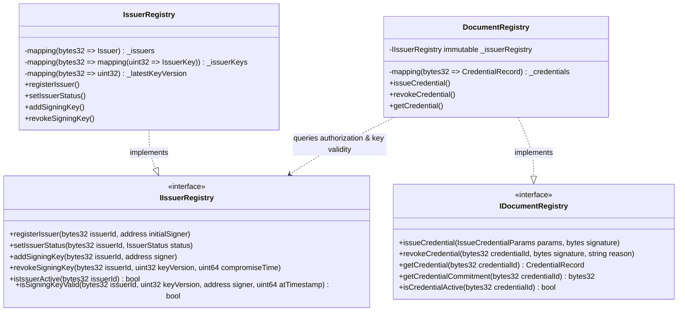

# Smart Contract Specification

## 1. Overview and Core Principles

The blockchain layer operates on **Polygon PoS** (Chain ID: `80002` for Polygon Amoy Testnet, `137` for Polygon Mainnet). It serves as the immutable, decentralized trust anchor for the platform.

### Core Architectural Mandates
1. **Zero Privacy Leakage:** Smart contracts store strictly cryptographic commitments (`bytes32`), credential identifiers (`bytes32`), timestamps (`uint64`), and authorization public keys (`address`). No personal data, employee/student names, document text, or document hashes are stored on-chain.
2. **EIP-712 Signature Enforcement:** The smart contract cryptographically enforces that every issued credential is authenticated by the private key belonging to an authorized signing key version registered in `IssuerRegistry`.
3. **Decoupled Relayer Model:** Anyone or any relayer service can submit a valid, issuer-signed issuance transaction. The validity of the issuance depends on the cryptographic EIP-712 signature and issuer status, not on `msg.sender`.
4. **Historical Auditability:** Signing key compromise policy accounts for historical issuance. A revoked or compromised key cannot issue new credentials, but documents legitimately issued prior to a recorded compromise timestamp remain verifiable according to policy.
5. **Standardized Toolchain:** Solidity `^0.8.28`, OpenZeppelin Contracts `5.x`, Hardhat 3, Ethers.js v6.

---

## 2. Architecture and Contract Interactions



---

## 3. Data Structures and Enums

### 3.1 Enums

```solidity
enum IssuerStatus {
    NONE,       // 0: Issuer not registered
    ACTIVE,     // 1: Authorized to issue and manage credentials
    SUSPENDED,  // 2: Temporarily suspended; cannot issue new credentials
    REVOKED     // 3: Permanently revoked; cannot issue new credentials
}

enum KeyStatus {
    NONE,        // 0: Key does not exist
    ACTIVE,      // 1: Currently active for signing
    ROTATED,     // 2: Deprecated by a newer key version
    REVOKED,     // 3: Revoked normally (no known historical compromise)
    COMPROMISED  // 4: Key private key was breached; invalidates signatures past compromiseTime
}

enum DocumentStatus {
    NONE,    // 0: Credential ID has not been registered
    ACTIVE,  // 1: Credential is active, valid, and authenticated
    REVOKED  // 2: Credential has been revoked by the authorized issuer
}
```

### 3.2 Structs

```solidity
struct Issuer {
    bytes32 issuerId;       // Opaque 32-byte identifier
    IssuerStatus status;    // Current status
    uint64 registeredAt;    // Unix timestamp of registration
    uint32 activeKeyVersion;// Currently active signing key version
}

struct IssuerKey {
    address signerAddress;  // Public address corresponding to private key
    KeyStatus status;       // Status of this specific key version
    uint64 effectiveAt;     // Activation timestamp
    uint64 revokedAt;       // Revocation timestamp (0 if not revoked)
    uint64 compromisedAt;   // Compromise timestamp (0 if not compromised)
}

struct CredentialRecord {
    bytes32 issuerId;       // Issuing organization ID
    bytes32 commitment;     // Keccak-256 privacy commitment
    uint64 issuedAt;        // Issuance timestamp declared in credential
    uint64 expiresAt;       // Expiration timestamp (0 if no expiration)
    uint32 keyVersion;      // Key version used to authorize issuance
    DocumentStatus status;  // ACTIVE or REVOKED
}

struct IssueCredentialParams {
    bytes32 issuerId;
    bytes32 credentialId;
    bytes32 commitment;
    uint64 issuedAt;
    uint64 expiresAt;
    uint32 keyVersion;
    uint32 schemaVersion;
}
```

---

## 4. EIP-712 Typed Structured Data

To prevent signature replay attacks across different applications, networks, and smart contracts, all off-chain issuer authorizations use **EIP-712**.

### 4.1 Domain Separator

```solidity
bytes32 public constant DOMAIN_TYPEHASH = keccak256(
    "EIP712Domain(string name,string version,uint256 chainId,address verifyingContract)"
);
```

- `name`: `"DecentralizedDocumentPlatform"`
- `version`: `"1"`
- `chainId`: `block.chainid` (e.g. `80002` for Polygon Amoy, `137` for Mainnet)
- `verifyingContract`: Address of the deployed `DocumentRegistry` contract

### 4.2 Credential Issuance Struct Hash

```solidity
bytes32 public constant ISSUE_CREDENTIAL_TYPEHASH = keccak256(
    "IssueCredential(bytes32 issuerId,bytes32 credentialId,bytes32 commitment,uint64 issuedAt,uint64 expiresAt,uint32 keyVersion,uint32 schemaVersion)"
);
```

The EIP-712 digest is computed as:
$$\text{Digest} = \text{keccak256}\left(\texttt{"\textbackslash x19\textbackslash x01"} \parallel \text{DOMAIN\_SEPARATOR} \parallel \text{hashStruct}(\text{params})\right)$$

### 4.3 Credential Revocation Struct Hash

```solidity
bytes32 public constant REVOKE_CREDENTIAL_TYPEHASH = keccak256(
    "RevokeCredential(bytes32 credentialId,bytes32 reasonHash,uint64 revokedAt)"
);
```

---

## 5. Contract: `IssuerRegistry.sol`

### 5.1 Roles and Access Control
- `DEFAULT_ADMIN_ROLE`: Platform multi-signature governance account.
- `ISSUER_MANAGER_ROLE`: Platform administrative account or hybrid governance contract authorized to approve and update issuer status.
- `PAUSER_ROLE`: Emergency operations account authorized to trigger emergency pause.

### 5.2 State Variables
- `mapping(bytes32 => Issuer) private _issuers;`
- `mapping(bytes32 => mapping(uint32 => IssuerKey)) private _issuerKeys;`
- `mapping(bytes32 => uint32) private _latestKeyVersion;`

### 5.3 Function Specifications

```solidity
/**
 * @notice Registers a new organization issuer with its initial signing key.
 * @dev Reverts if issuerId is empty, already registered, or signer is zero address.
 */
function registerIssuer(bytes32 issuerId, address initialSigner) 
    external 
    onlyRole(ISSUER_MANAGER_ROLE) 
    whenNotPaused;

/**
 * @notice Updates the administrative status of an issuer (ACTIVE, SUSPENDED, REVOKED).
 */
function setIssuerStatus(bytes32 issuerId, IssuerStatus status) 
    external 
    onlyRole(ISSUER_MANAGER_ROLE);

/**
 * @notice Adds a new signing key version for an issuer, rotating the previous key.
 */
function rotateSigningKey(bytes32 issuerId, address newSigner) 
    external 
    onlyRole(ISSUER_MANAGER_ROLE) 
    whenNotPaused 
    returns (uint32 newVersion);

/**
 * @notice Marks a specific signing key version as revoked or compromised.
 * @param compromiseTime If non-zero, signatures made after this timestamp are deemed invalid.
 */
function revokeSigningKey(bytes32 issuerId, uint32 keyVersion, uint64 compromiseTime) 
    external 
    onlyRole(ISSUER_MANAGER_ROLE);

/**
 * @notice Returns true if the issuer is active for new issuances.
 */
function isIssuerActive(bytes32 issuerId) external view returns (bool);

/**
 * @notice Validates whether a specific signer address was authorized for an issuer at a specific timestamp.
 */
function isSigningKeyValid(
    bytes32 issuerId, 
    uint32 keyVersion, 
    address signer, 
    uint64 atTimestamp
) external view returns (bool);
```

---

## 6. Contract: `DocumentRegistry.sol`

### 6.1 State Variables
- `IIssuerRegistry public immutable issuerRegistry;`
- `mapping(bytes32 => CredentialRecord) private _credentials;`

### 6.2 Function Specifications

```solidity
/**
 * @notice Issues a new credential onto the Polygon blockchain.
 * @dev Verifies that:
 *      1. The credentialId has not been registered before (anti-replay).
 *      2. The issuer is currently ACTIVE in IssuerRegistry.
 *      3. The EIP-712 signature recovers to the authorized signing key for keyVersion.
 *      4. The key was valid at issuedAt and not compromised prior to issuedAt.
 *      5. Timestamps are logically consistent (issuedAt <= block.timestamp, expiresAt == 0 || expiresAt > issuedAt).
 */
function issueCredential(
    IssueCredentialParams calldata params, 
    bytes calldata signature
) external whenNotPaused;

/**
 * @notice Revokes an existing credential.
 * @dev Requires a valid EIP-712 RevokeCredential signature from an authorized key of the issuing organization,
 *      or can be called by an account with EMERGENCY_GUARDIAN_ROLE.
 */
function revokeCredential(
    bytes32 credentialId, 
    bytes32 reasonHash, 
    uint64 revokedAt, 
    bytes calldata signature
) external whenNotPaused;

/**
 * @notice Returns the full on-chain record for a credential.
 */
function getCredential(bytes32 credentialId) external view returns (CredentialRecord memory);

/**
 * @notice Returns the Keccak-256 commitment for direct cryptographic comparison.
 */
function getCredentialCommitment(bytes32 credentialId) external view returns (bytes32);

/**
 * @notice Returns true if the credential exists, is ACTIVE, and has not expired.
 */
function isCredentialActive(bytes32 credentialId) external view returns (bool);
```

---

## 7. Custom Errors

```solidity
error IssuerAlreadyExists(bytes32 issuerId);
error IssuerNotFound(bytes32 issuerId);
error IssuerNotActive(bytes32 issuerId);
error InvalidSignerAddress();
error KeyVersionNotFound(bytes32 issuerId, uint32 keyVersion);
error KeyAlreadyRevoked(bytes32 issuerId, uint32 keyVersion);
error KeyCompromised(bytes32 issuerId, uint32 keyVersion, uint64 compromiseTime);
error SignerNotAuthorized(bytes32 issuerId, uint32 keyVersion, address recoveredSigner);
error CredentialAlreadyExists(bytes32 credentialId);
error CredentialNotFound(bytes32 credentialId);
error CredentialAlreadyRevoked(bytes32 credentialId);
error InvalidSignature();
error InvalidTimestamps();
error InvalidCommitment();
```

---

## 8. Events Emitted

```solidity
event IssuerRegistered(bytes32 indexed issuerId, address indexed initialSigner, uint64 timestamp);
event IssuerStatusChanged(bytes32 indexed issuerId, IssuerStatus previousStatus, IssuerStatus newStatus, uint64 timestamp);
event SigningKeyAdded(bytes32 indexed issuerId, uint32 indexed keyVersion, address indexed signer, uint64 effectiveAt);
event SigningKeyRevoked(bytes32 indexed issuerId, uint32 indexed keyVersion, uint64 revokedAt, uint64 compromisedAt);

event CredentialIssued(
    bytes32 indexed credentialId,
    bytes32 indexed issuerId,
    bytes32 commitment,
    uint32 keyVersion,
    uint64 issuedAt,
    uint64 expiresAt
);

event CredentialRevoked(
    bytes32 indexed credentialId,
    bytes32 indexed issuerId,
    bytes32 reasonHash,
    uint64 revokedAt
);
```

---

## 9. Security Invariants and Attack Mitigations

1. **Replay Protection:** Every `credentialId` is unique and checked via `require(_credentials[params.credentialId].status == DocumentStatus.NONE)`. Re-issuing the same credential ID immediately reverts with `CredentialAlreadyExists`.
2. **Cross-Domain Replay Protection:** EIP-712 includes `verifyingContract` and `block.chainid`. A signature created for Polygon Amoy cannot be submitted to Polygon Mainnet or an unauthorized clone.
3. **Malleability Protection:** Signatures are validated using OpenZeppelin's `ECDSA.recover`, which rejects malleated signatures ($s$-value in upper half of curve order).
4. **Zero State Collision:** The commitment includes `commitmentVersion`, `credentialId`, `issuerId`, `documentHash`, and `nonce`, ensuring zero probability of accidental commitment collision.
5. **No Blind Trust in `msg.sender`:** The contract authorizes issuance solely based on the cryptographic signature of the authorized issuer key. The relayer wallet merely pays gas.

