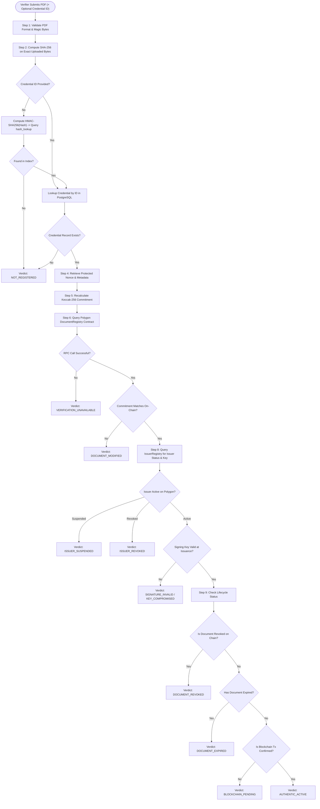

# Document Verification Workflow Specification

## 1. Overview and Core Philosophy

The **Verification Engine** is the central, mission-critical component of the platform. It provides independent, mathematically verifiable proof of whether a document presented by a candidate or applicant is authentic, authorized, and unaltered.

### Fundamental Verification Principles
1. **Never Assume Authenticity:** Verification is a zero-trust pipeline. Every step must independently pass before an `AUTHENTIC_ACTIVE` verdict is rendered.
2. **Never Conflate "Not Found" with "Tampered":**
   - If an unindexed PDF is uploaded *without* a credential ID, the system must report `NOT_REGISTERED`. It is mathematically impossible to know whether the file is a modified registered document or simply an unrelated document never registered on the platform.
   - Only when a specific `credentialId` is provided (via QR code or manual input) and the recalculated commitment fails to match the on-chain commitment can the engine definitively state **`DOCUMENT_MODIFIED`**.
3. **Graceful Degradation on RPC Failure:** If the Polygon blockchain RPC is unreachable or times out, the engine must return **`VERIFICATION_UNAVAILABLE`**. It must **never** report success based on cached database records alone.

---

## 2. The Multi-Step Verification Engine Pipeline

---

## 3. Step-by-Step Technical Execution

### Step 1: PDF Structure & Format Validation
- Stream-check the first 5 bytes for PDF magic header: `0x25 0x50 0x44 0x46 0x2D` (`%PDF-`).
- Validate file size does not exceed the platform ceiling (25 MB).
- Reject encrypted/password-protected PDFs that prevent stream verification.

### Step 2: Exact Byte Stream SHA-256 Calculation
- Stream uploaded bytes through Node.js `crypto.createHash('sha256')`.
- Produce the 32-byte binary digest:
  $$H_{\text{uploaded}} = \text{SHA-256}(\text{bytes}_{\text{uploaded}})$$

### Step 3: Credential Resolution
- **Path A (Direct Lookup):** If `credentialId` is supplied (from QR scan or URL `/verify/:id`), fetch the document record and associated encrypted nonce from PostgreSQL.
- **Path B (Index Lookup):** If `credentialId` is omitted:
  1. Compute lookup key:
     $$I_{\text{lookup}} = \text{HMAC-SHA256}(H_{\text{uploaded}}, K_{\text{hmac}})$$
  2. Query `file_objects` where `hash_lookup == I_lookup`.
  3. If no matching record exists, terminate immediately with **`NOT_REGISTERED`**.

### Step 4: Retrieve Protected Cryptographic Nonce
- Decrypt the 32-byte CSPRNG nonce associated with the credential record using envelope decryption (KMS / master KEK).
- Decrypt the issuer's opaque 32-byte `issuerId`.

### Step 5: Recalculate Cryptographic Commitment
- Assemble the standardized ABI encoding:
  $$\text{EncodedData} = \text{abi.encode}\left(\text{version}=1, \text{credentialId}, \text{issuerId}, H_{\text{uploaded}}, \text{nonce}\right)$$
- Compute Keccak-256:
  $$C_{\text{recalculated}} = \text{Keccak-256}(\text{EncodedData})$$

### Step 6: Query Polygon PoS Smart Contract
- Instantiate read-only `DocumentRegistry` contract instance via Ethers.js v6.
- Call `getCredential(credentialId)`.
- If RPC timeout or network failure occurs, return **`VERIFICATION_UNAVAILABLE`**.

### Step 7: Commitment Comparison
- Compare $C_{\text{recalculated}}$ with on-chain $C_{\text{on-chain}}$:
  - If $C_{\text{recalculated}} \neq C_{\text{on-chain}}$, the file content has been altered since registration. Terminate with **`DOCUMENT_MODIFIED`**.

### Step 8: Issuer & Signing Key Authorization Audit
- Call `IssuerRegistry.isIssuerActive(issuerId)`.
  - If status is `SUSPENDED`, set verdict flag to `ISSUER_SUSPENDED`.
  - If status is `REVOKED`, set verdict flag to `ISSUER_REVOKED`.
- Call `IssuerRegistry.isSigningKeyValid(issuerId, keyVersion, signerAddress, issuedAt)`.
  - Verify that the signing key was authorized at `issuedAt` and was not subject to a prior compromise timestamp.

### Step 9: Lifecycle & Expiration Checks
- Check on-chain document status:
  - If `status == DocumentStatus.REVOKED`, return **`DOCUMENT_REVOKED`**.
- Check expiration:
  - If `expiresAt > 0` and `block.timestamp >= expiresAt`, return **`DOCUMENT_EXPIRED`**.
- Check transaction confirmations:
  - Verify minimum block depth (e.g. 5 blocks on Polygon Amoy). If unconfirmed, return **`BLOCKCHAIN_PENDING`**.

---

## 4. Verification Verdict Codes

| Code | HTTP Status | Visual Badge | Meaning |
|---|---|---|---|
| `AUTHENTIC_ACTIVE` | 200 | Green Checkmark | Document is 100% authentic, unaltered, issued by an authorized active issuer, and confirmed on Polygon. |
| `DOCUMENT_MODIFIED` | 200 | Red Alert | The uploaded document's SHA-256 does not match the original registration for this credential ID. The document has been tampered with. |
| `NOT_REGISTERED` | 200 | Gray Shield | No registration was found for this document or credential ID. |
| `DOCUMENT_REVOKED` | 200 | Orange Alert | The document was legitimately issued, but has since been revoked by the authorized issuing organization. |
| `DOCUMENT_EXPIRED` | 200 | Yellow Warning | The document was validly issued but passed its stated expiration date. |
| `ISSUER_SUSPENDED` | 200 | Amber Warning | The issuing organization is currently suspended by platform governance. Historical issuance preserved with warning. |
| `ISSUER_REVOKED` | 200 | Red Alert | The issuing organization has been permanently revoked by governance. |
| `SIGNATURE_INVALID` | 200 | Red Alert | The digital signature does not match any authorized signing key for this issuer. |
| `BLOCKCHAIN_PENDING` | 200 | Blue Spinner | The issuance transaction has been submitted to Polygon but is awaiting required block confirmations. |
| `VERIFICATION_UNAVAILABLE` | 503 | Purple Warning | The Polygon RPC network is unreachable. Live verification could not be completed safely. |

---

## 5. Walkthrough: Rahul's Tampered Experience Letter

Let us walk through the exact prompt scenario:

1. **Original Registration:**
   - Document: Experience Letter issued by Company A.
   - Text: "Designation: Junior Developer. Tenure: 2024–2026."
   - SHA-256: `0x89fd10...`
   - Nonce: `0x1a2b3c...`
   - Credential ID: `0x4a7e91...`
   - Commitment stored on Polygon: `0xb3c812...`
2. **Tampering:**
   - Rahul opens the PDF in an editor and alters "Junior Developer" to "Senior Developer" and "2024" to "2023".
   - The file size and stream bytes change.
3. **Verification by Company B:**
   - Company B uploads the modified PDF and enters `credentialId = 0x4a7e91...` (or scans the QR code).
   - Engine hashes the uploaded bytes:
     $$\text{SHA-256}(\text{modified bytes}) = \text{0x5f2e88...} \neq \text{0x89fd10...}$$
   - Engine recalculates commitment:
     $$C_{\text{recalculated}} = \text{Keccak-256}(\text{version}, \text{0x4a7e91...}, \text{issuerId}, \text{0x5f2e88...}, \text{0x1a2b3c...}) = \text{0x999aaa...}$$
   - Engine reads Polygon contract:
     $$C_{\text{on-chain}} = \text{0xb3c812...}$$
   - Comparison:
     $$\text{0x999aaa...} \neq \text{0xb3c812...}$$
   - **Engine output:** `DOCUMENT_MODIFIED`.
   - The report displays:
     - Check 1 (Document Integrity): **FAILED (Byte fingerprint mismatch)**.
     - Check 2 (Issuer Identity): Company A (Verified).
     - Check 3 (Original Blockchain Commitment): Unchanged on Polygon.

